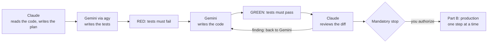

# claude-gemini-architect

**Save Claude tokens: Claude designs the plan, Gemini does the heavy lifting through Antigravity (`agy`), and Claude reviews the diff at the end.**

[](https://www.npmjs.com/package/claude-gemini-architect)
[](https://github.com/francisco-gomes/claude-gemini-architect/actions/workflows/ci.yml)
[](LICENSE)

A skill for [Claude Code](https://claude.com/claude-code).

## Why

In a coding task, most of the tokens go to writing code, writing tests, running them and fixing what fails. This skill hands that part to **Gemini, through the Antigravity CLI (`agy`)**, and keeps Claude on the two jobs where it adds the most:

1. **Designing the plan:** a contract with exact test cases, the list of files to touch, and commands that judge themselves (`OK` / `FAILED`).
2. **Reviewing the diff** of every commit, without trusting the executor's report.

The contract is what makes the split safe. Without it a fast executor improvises: it loosens a test, overwrites a file, or reports tests that never ran. Claude then spends on rework the tokens it saved.

## How it works



Claude's tokens go to the plan and the review. The code, the tests and the fix loops are Gemini's.

## Quick start

```bash
npx claude-gemini-architect
```

Then, in Claude Code:

```
/claude-gemini-architect add a slugify(text) function to src/text.ts, with tests
```

Claude reads the code and writes the plan. Gemini writes the tests, which must fail first, then the code, which must make them pass. Claude reviews each diff, and nothing touches production until you say so.

The skill also triggers on plain requests such as *"let Gemini do the heavy lifting"*, *"you design, agy executes"*, *"manda o agy fazer"* or *"o gemini faz o pesado e você confere"*.

## Two modes

The skill picks the mode by itself (`HERDR_ENV=1` means herdr).

| | Terminal mode | herdr mode |
|---|---|---|
| Where Gemini runs | `agy -p`, headless, one call per step | interactive `agy` in a herdr pane next to Claude |
| Who writes code and tests | Gemini | Gemini |
| Who runs the plan's commands | Claude (headless `agy` denies every command) | Gemini, each command checked by the watchdog |
| Who commits | Claude, after the review | Gemini, through the plan's commit block; Claude reviews each commit as it lands |
| Production (Part B) | Claude, step by step | Gemini, each command approved by hand |

## Requirements

| Tool | Needed for |
|---|---|
| Claude Code | running the skill |
| `agy` (Antigravity CLI), logged in | Gemini, the executor |
| Python 3 | the helper scripts |
| git | commits and reviews |
| herdr *(optional)* | herdr mode; without it only terminal mode works |
| `gh` *(optional)* | Part B: opening the PR, checking CI and merging. Without it, do those steps on github.com |

`npx claude-gemini-architect --check` tells you what is missing.

## Install options

```bash
npx claude-gemini-architect              # ~/.claude/skills/claude-gemini-architect ($CLAUDE_CONFIG_DIR/skills if set)
npx claude-gemini-architect --project    # <repo root>/.claude/skills/claude-gemini-architect (this repo only)
npx claude-gemini-architect --force      # replace an existing installation without asking
npx claude-gemini-architect --uninstall  # remove it (respects --project)
npx claude-gemini-architect --check      # only check the requirements
```

The installer has no dependencies. It copies the skill atomically, so a failure never leaves half a skill behind, and it never deletes a folder it didn't create unless you pass `--force`.

Manual install:

```bash
git clone https://github.com/francisco-gomes/claude-gemini-architect
cp -r claude-gemini-architect/skill ~/.claude/skills/claude-gemini-architect
```

## Security model

- **Headless `agy` can't run commands, and the skill keeps it that way.** It never uses `--dangerously-skip-permissions` and never adds allow rules to agy's settings. Those rules match by prefix, so a "narrow" `npx vitest run*` also allows `npx vitest run && ./deploy.sh prod`. If you want a bypass anyway, that's a change you make in your own settings; the skill won't make it for you.
- **The watchdog (herdr mode, Part A only)** approves on its own only two kinds of command: a command identical to a bash block of the plan's Part A (which Claude wrote and reviewed), and read-only commands such as `cat`, `ls`, `grep` or `git status/log/diff`. Anything else (a push, an install, a variant it doesn't recognize, a command cut off on screen) stops it and hands the decision to Claude. Extra patterns veto even read-only commands:
  ```bash
  export GEMINI_ARCHITECT_EXTRA_DENY='\.env\b|secrets/'
  ```
- **What the watchdog is not:** it guards against an executor's mistakes and improvisation, not against a hostile model. A model that edits `.git/config` or writes a script, and then asks for a command the watchdog approves, can still run code. If you don't trust the executor, run it in a container or a VM.
- **Production (Part B) is never automatic.** It starts only after you explicitly authorize merge and deploy, and it runs one step at a time, each result checked before the next.

## Does it really save tokens?

It isn't measured yet. The design moves the most expensive part of the work (code, tests, fix loops) to Gemini, and Claude's part is kept small on purpose: the plan, plus a diff review that reads `git show --stat` and the diff instead of whole files. A benchmark with real numbers is planned. Until it exists, this README won't claim a percentage.

## How the skill was tested

The skill text was written test-first: pressure scenarios were run on subagents **without** the skill, and the text targets only what failed. For example, asked to "make Gemini run its own commands", all 3 runs without the skill added allow rules to agy's settings; with the skill, none did. Plans went from 4/7 to 7/7 on the rubric. Scenarios, rubric and every result: [`skill-tests/`](skill-tests/RESULTS.md).

## Docs

- [How it works](docs/how-it-works.md): the phases, who pays which tokens, the helper scripts
- [Writing plans](docs/writing-plans.md): the contract rules and a complete small example
- [Troubleshooting](docs/troubleshooting.md)

## Contributing

See [CONTRIBUTING.md](CONTRIBUTING.md).

## License

[MIT](LICENSE)
